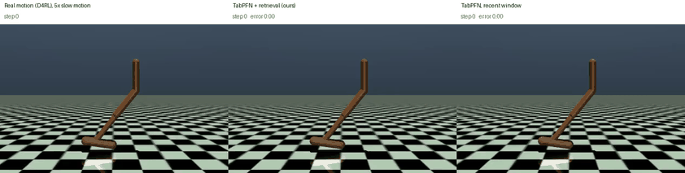
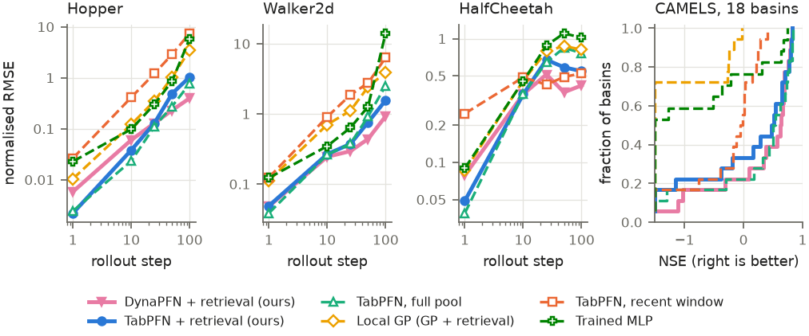

# Retrieve, Then Roll Out: Context Selection for In-Context World Models

Code, results and demos for the paper *Retrieve, Then Roll Out: Context Selection for In-Context World
Models* (Nouar AlDahoul, New York University Abu Dhabi; in preparation for ICWM 2027).

Pretrained tabular foundation models such as [TabPFN](https://github.com/PriorLabs/TabPFN) can act as
world models without any training: given observed transitions in context, they predict the next state of
a dynamical system. With a context made of the most recent transitions, their multi-step rollouts
degrade quickly. We show that **which** transitions enter the context matters more than how many:
retrieving the transitions nearest to the current state, and re-selecting them at every rollout step,
turns in-context foundation models into accurate training-free world models.

## Demo: what the world model predicts

Open-loop rollouts from the same start state with the same recorded actions (D4RL test episode, seed 0).
Left: the real motion. Middle: TabPFN with **retrieved context (ours)**. Right: TabPFN with the recent
window used in prior work. The number in each panel is the normalised rollout error.

**Walker2d** (5x slow motion): error after 100 steps 1.71 with retrieval vs 30.3 with the recent window


**Hopper** (5x slow motion): error after 100 steps 1.96 vs 5.37



**HalfCheetah** (real time): 0.32 vs 0.48 - its periodic gait keeps the recent window relevant


Full-resolution videos: [`demo/*.mp4`](demo/); errors per horizon: [`demo/*.json`](demo/).

## Main findings

* **Retrieval makes in-context world models work.** Relative to the recent window, retrieved context
  reduces TabPFN's rollout error by a factor of 315 on Lorenz-63 and 25 on a forced pendulum (300 steps,
  10/10 seeds), and by 7.9 on Hopper and 4.9 on Walker2d (100 steps, 10/10 seeds). The gain holds for
  TabPFN v2, v3.5 and v3.5-fast, and for DynaPFN-style features.
* **Where foundation models beat a classic local Gaussian process.** On contact-rich D4RL locomotion and
  real river flow (CAMELS), TabPFN-family models with retrieved context are more accurate than a local
  Gaussian process (a GP fitted to the same retrieved transitions) on 9-10 of 10 seeds and 17 of 18
  basins (up to 8.2x on Hopper). The local GP wins only on noise-free simulated ODEs, which it
  interpolates almost exactly; with observation noise or impacts its advantage disappears.
* **Counterfactual action effects.** With single-policy data, every model fits the logged transitions
  but not the effect of other actions. A small amount of exploratory data fixes this for contexts that
  can reach it - retrieval or the full pool - but never for the recent window.
* **Honest limits.** On smooth noise-free ODEs the local GP is more accurate (TabPFN has a precision
  floor); on Lorenz-96 retrieved contexts are too narrow; closed-loop sampling-based planning on the D4RL
  robots stays far below the planner with the true dynamics (which itself falls on Hopper), so
  retrieval's gains in prediction do not carry over to control there.




## Repository layout

| Path | Content |
|---|---|
| `code/study.py` | Main experiment: pools, context strategies (recent / random / full / retrieval), models (TabPFN, DynaPFN-style features, GP, MLP, local linear, kNN, context parroting), rollouts and metrics |
| `code/pilot.py` | Simulators (Lorenz-63, pendulum), model wrappers, context selection |
| `code/mpc.py` | CEM model-predictive control: cart-pole and acrobot swing-up, trajectory retrieval |
| `code/cheetah_mpc.py` | CEM-MPC on MuJoCo HalfCheetah / Hopper / Walker2d with a TabPFN world model |
| `code/counterfactual.py` | Counterfactual (interventional) evaluation with the simulator as ground truth |
| `code/scaling.py` | Cost and accuracy of retrieval vs the full pool as the pool grows |
| `code/predict_video.py`, `code/replay_video.py` | Prediction-comparison videos; re-rendering from saved actions |
| `code/diag.py` | Diagnostics: precision floor, context width, GP on contact transitions |
| `code/analyze_full.py`, `code/paper_*.py` | Seed-level analysis, all paper tables, figures and in-text numbers |
| `code/regtest/` | Regression and correctness checks (simulator consistency, GP fixes, counterfactual metrics, ...) |
| `jobs/` | Slurm job scripts and task lists used on the NYU Abu Dhabi Jubail HPC cluster |
| `results/results_jsons.tar.gz` | All raw result files (one JSON per task) |
| `figures/` | Paper figures (PDF and PNG) |

## Reproducing

Environment used (NVIDIA A100 80 GB): Python 3.11.17, `tabpfn==9.2.0` (with the TabPFN v2, v3.5 and
v3.5-fast weights), `torch==2.14.1` (CUDA 13.0), `numpy==2.4.6`, `scipy==1.17.1`, `scikit-learn==1.9.1`,
`matplotlib==3.11.2`; for the robot simulation `gymnasium==1.4.0`, `mujoco==4.0.1`, `imageio==2.38.1`.

1. Data: D4RL `hopper/halfcheetah/walker2d-medium-v2` and 18 CAMELS basins, converted with
   `code/prep_data.py` (public datasets; not redistributed here).
2. Experiments: each line of `jobs/tasks_*.txt` is one call of `code/study.py` (or the script named in
   the job file); `jobs/pack.sbatch` runs a task file on one GPU. Paths in the job files point to our
   cluster and need to be adapted.
3. Analysis: unpack `results/results_jsons.tar.gz` into `code/results/` and run
   `python paper_assets.py` from `code/` - it regenerates every table, figure and number in the paper.

Seeds are the unit of analysis: rollout starts of a seed are averaged (geometric mean) and methods are
compared with paired Wilcoxon signed-rank tests over seeds.

## Citation

```
@misc{aldahoul2026retrieve,
  title  = {Retrieve, Then Roll Out: Context Selection for In-Context World Models},
  author = {AlDahoul, Nouar},
  year   = {2026},
  note   = {In preparation}
}
```

## License

Code: MIT (see `LICENSE`). The DynaPFN-style baseline re-implements the feature library of
[DynaPFN](https://github.com/chiararov/DynaPFN) (MIT). D4RL, CAMELS, TabPFN, Gymnasium and MuJoCo are
used under their own licenses.
