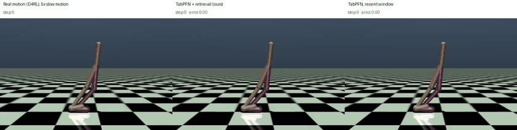
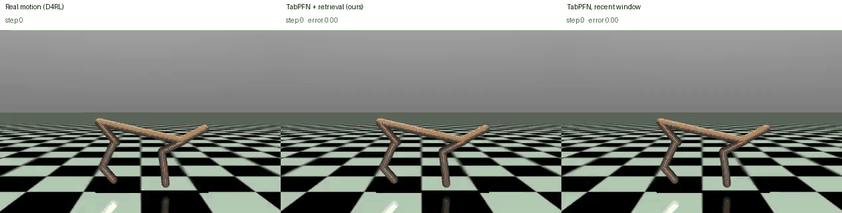
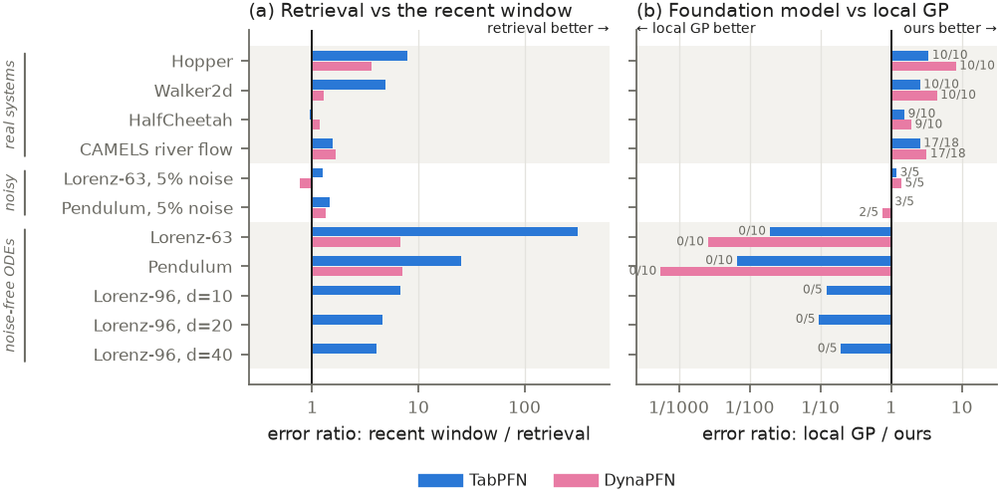
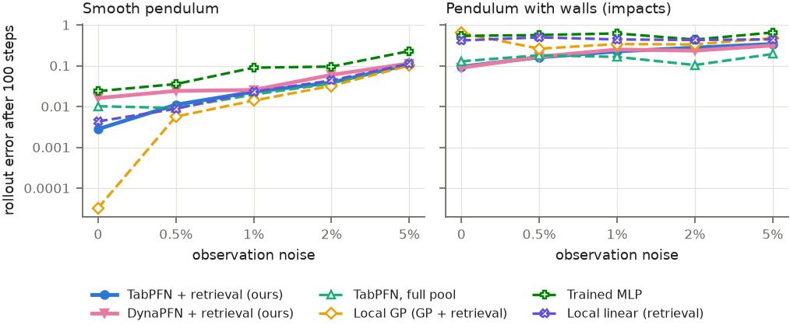
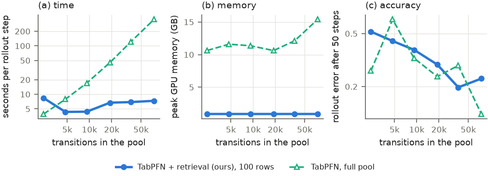
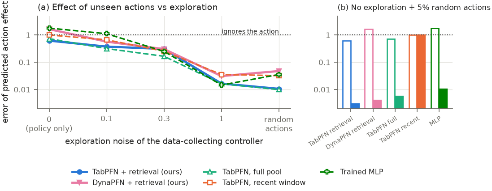
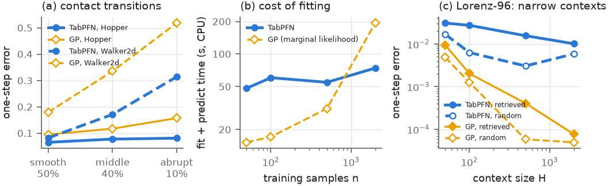

<div align="center">

# Retrieve, Then Roll Out

### Context selection for in-context world models

**Nouar AlDahoul** · New York University Abu Dhabi




<sub><b>Walker2d, open-loop rollout from the same start with the same recorded actions</b> (5× slow motion).
Left: real motion · Middle: TabPFN + <b>retrieved context (ours)</b> · Right: TabPFN + recent window (prior work).
Error after 100 steps: <b>1.71</b> vs 30.3.</sub>

</div>

---

## TL;DR

Pretrained tabular foundation models such as [TabPFN](https://github.com/PriorLabs/TabPFN) can act as
**training-free world models**: given observed transitions in context, they predict the next state of a
dynamical system. With the usual *recent-window* context their rollouts drift and collapse.
**We show that *which* transitions enter the context matters more than how many:** retrieving the
transitions nearest to the current state, and re-selecting them at every rollout step, turns in-context
foundation models into accurate world models — at a cost that stays constant as data grow.

## Highlights

| | Result |
|---|---|
| 🎯 **Retrieval fixes rollouts** | **315×** lower error than the recent window on Lorenz-63, **25×** on a forced pendulum, **7.9×** on Hopper, **4.9×** on Walker2d (10/10 seeds) |
| 🤖 **Beats a classic local GP where it matters** | **8.2×** on Hopper, **4.5×** on Walker2d, **3.2×** on real river flow (CAMELS, 17/18 basins) |
| 🧱 **Explains when the GP wins** | GP is 93× better on a smooth noise-free pendulum — add impacts and **ours wins 12×** (5/5 seeds) |
| 🔀 **Counterfactual action effects** | 5% exploratory data roughly halves the action-effect error with retrieval; the recent window never benefits |
| ⏱️ **Constant cost** | full-pool context grows from 3.9 s to **352 s** per step as the pool grows to 75k transitions; retrieval stays at **4–8 s** and **0.9 GB** |
| 🔁 **General** | holds for TabPFN v2 / v3.5 / v3.5-fast and DynaPFN-style features; 9 systems from chaos to robots to hydrology |

## More rollouts

<table>
<tr>
<td align="center" width="50%"><br/><sub><b>Hopper</b> (5× slow motion) · error after 100 steps <b>1.96</b> vs 5.37</sub></td>
<td align="center" width="50%"><br/><sub><b>HalfCheetah</b> (real time) · 0.32 vs 0.48 — a periodic gait keeps the recent window relevant</sub></td>
</tr>
</table>

Full-resolution videos and per-horizon errors: [`demo/`](demo/).

## Where foundation models win

<p align="center"></p>

**(a)** Retrieved vs recent-window context for the same model. **(b)** Local Gaussian process vs our
foundation models, both with retrieved context — the GP wins only on noise-free simulated ODEs.

<p align="center"></p>

Rollout error over the horizon on D4RL locomotion (left) and the distribution of Nash–Sutcliffe
efficiency over 18 CAMELS river basins (right): solid = ours, dashed = baselines.

<details>
<summary><b>More figures</b> (noise × impacts, cost, counterfactuals, diagnostics)</summary>

<p align="center"></p>
<p align="center"></p>
<p align="center"></p>
<p align="center"></p>

</details>

## Honest limitations

- On **smooth, noise-free ODEs** a local Gaussian process is more accurate (TabPFN has a precision floor).
- On **Lorenz-96**, retrieved contexts become too narrow and a larger context is better.
- With a very large pool, the **full pool can be more accurate** — at 48× the cost per step.
- **Closed-loop control** with a sampling-based planner stays far below the true-dynamics planner on the
  D4RL robots (which itself falls on Hopper): retrieval improves prediction there, not control.

## Quick start

```bash
git clone https://github.com/Nouar-NYUAD/retrieve-then-rollout.git
cd retrieve-then-rollout/code

# regenerate every table, figure and number of the paper from the raw results
mkdir -p results && tar xzf ../results/results_jsons.tar.gz -C results
python paper_assets.py

# one experiment: TabPFN on Hopper with retrieved vs recent-window context
python study.py --system hopper --seed_ids 0 --models tabpfn --strategies retrieval recent \
    --H 100 --n_train 10 --t0_min 100 --horizon 100 --n_starts 3 --data_dir /path/to/d4rl_npz --out hopper_s0.json
```

**Environment** (NVIDIA A100 80 GB): Python 3.11.17, `tabpfn==9.2.0` (TabPFN v2, v3.5 and v3.5-fast
weights), `torch==2.14.1` (CUDA 13.0), `numpy==2.4.6`, `scipy==1.17.1`, `scikit-learn==1.9.1`,
`matplotlib==3.11.2`; for the robots `gymnasium==1.4.0`, `mujoco==4.0.1`, `imageio==2.38.1`.
**Data:** D4RL `hopper / halfcheetah / walker2d-medium-v2` and 18 CAMELS basins, prepared with
`code/prep_data.py` (public datasets, not redistributed here).

## Repository layout

| Path | Content |
|---|---|
| [`code/study.py`](code/study.py) | Main experiment: pools, context strategies (recent / random / full / retrieval), all models, rollouts, metrics |
| [`code/pilot.py`](code/pilot.py) | Simulators, model wrappers, context selection |
| [`code/mpc.py`](code/mpc.py), [`code/cheetah_mpc.py`](code/cheetah_mpc.py) | CEM model-predictive control: cart-pole, acrobot, MuJoCo robots |
| [`code/counterfactual.py`](code/counterfactual.py) | Counterfactual action-effect test with the simulator as ground truth |
| [`code/scaling.py`](code/scaling.py) | Cost and accuracy of retrieval vs the full pool as data grow |
| [`code/predict_video.py`](code/predict_video.py) | The prediction-comparison videos above |
| [`code/diag.py`](code/diag.py) | Diagnostics: precision floor, context width, contact transitions |
| [`code/paper_*.py`](code/), [`code/analyze_full.py`](code/analyze_full.py) | Seed-level analysis, every table, figure and number in the paper |
| [`code/regtest/`](code/regtest/) | Correctness checks (simulator consistency, GP fixes, counterfactual metrics, …) |
| [`jobs/`](jobs/) | Slurm job scripts and task lists (NYU Abu Dhabi Jubail HPC) |
| [`results/`](results/) | All raw result files (one JSON per task) |

Seeds are the unit of analysis: rollout starts of a seed are averaged (geometric mean), and methods are
compared with paired Wilcoxon signed-rank tests over seeds.

## Citation

```bibtex
@misc{aldahoul2026retrieve,
  title  = {Retrieve, Then Roll Out: Context Selection for In-Context World Models},
  author = {AlDahoul, Nouar},
  year   = {2026},
  note   = {In preparation for ICWM 2027}
}
```

## License

Code released under the [MIT license](LICENSE). The DynaPFN-style baseline re-implements the feature
library of [DynaPFN](https://github.com/chiararov/DynaPFN) (MIT). D4RL, CAMELS, TabPFN, Gymnasium and
MuJoCo are used under their own licenses.
